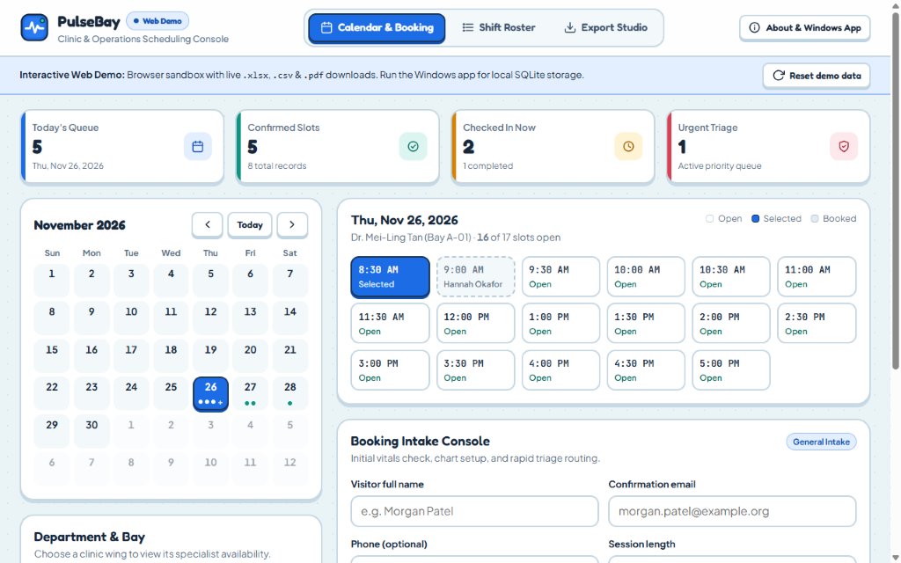
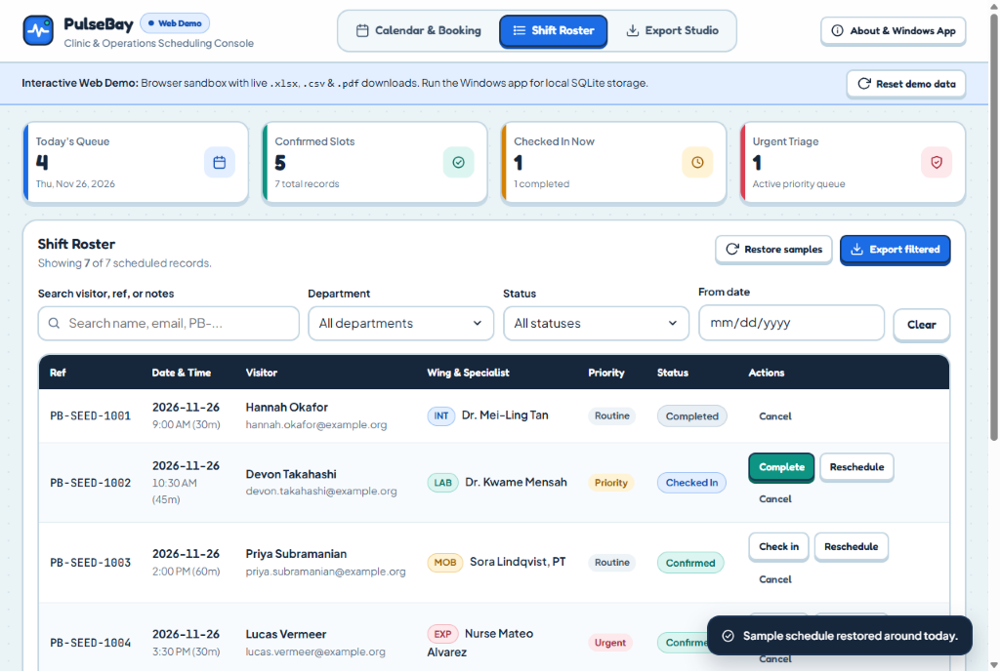
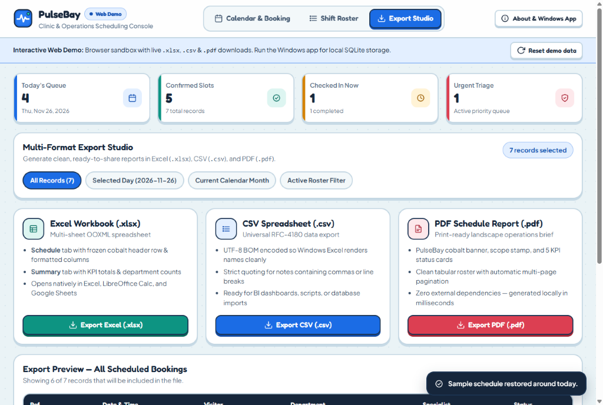
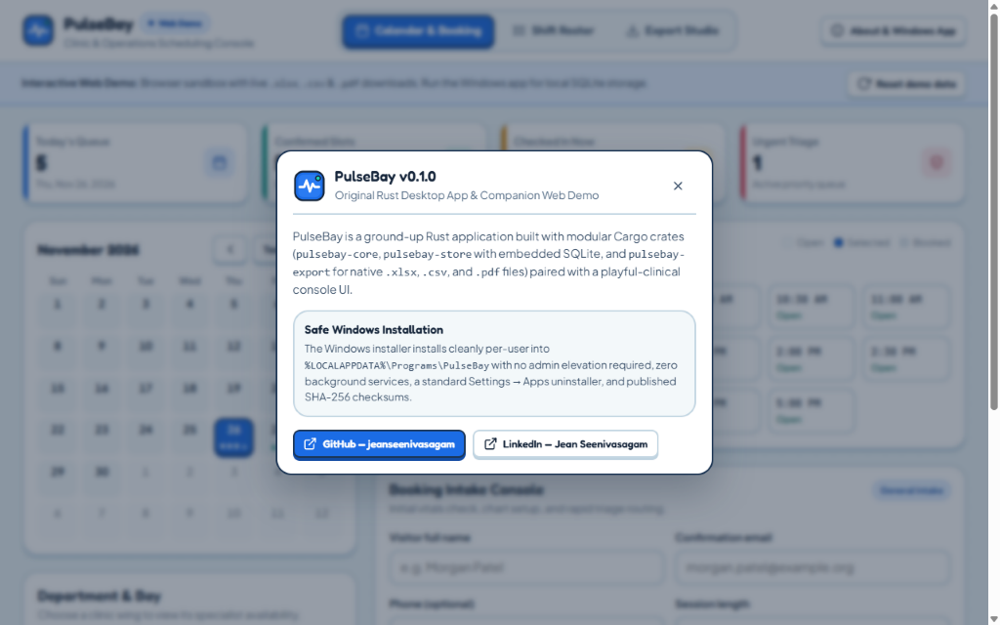

# PulseBay — Operations & Booking Console

**PulseBay** is an original, offline-first clinic and operations scheduling console written in **Rust**, paired with an interactive **Companion Web Demo** and a **user-level Windows installer**.

Designed with a playful-yet-crisp clinical console visual system (rounded tactile bevel cards, high-contrast status pills, clear bay/wing indicators, and tabular time slots), PulseBay helps teams manage daily schedules, prevent double-booking conflicts, and export clean reports without cloud lock-in.

- **Author:** Jean Seenivasagam
- **GitHub:** https://github.com/jeanseenivasagam/
- **LinkedIn:** https://www.linkedin.com/in/jeanseenivasagam/

---

## Screenshots

### Calendar & Booking Console


### Shift Roster & Live Status Transitions


### Multi-Format Export Studio (`.xlsx`, `.csv`, `.pdf`)


### About & Safe Windows Installation Overview


---

## Key Features

- **Interactive Calendar & Slot Booking:** Browse months, inspect per-day queue dots, select a clinic wing/department (`General Intake`, `Diagnostics Lab`, `Mobility & Recovery`, `Express Follow-Up`), pick open 30-minute time slots (`08:30 AM`–`05:00 PM`) with live conflict prevention, and receive a tactile confirmation ticket with reference code (`PB-YYYYMMDD-XXXX`).
- **Shift Roster Management:** Filter and search bookings by visitor, reference code, department, status, or date; transition records across `Confirmed → Checked In → Completed` or `Cancelled`; and reschedule bookings in a Top-Layer modal with automatic conflict checks.
- **Multi-Format Schedule Exports (`.xlsx`, `.csv`, `.pdf`):**
  - **Excel (`.xlsx`):** Multi-sheet OOXML workbook (`Schedule` + `Summary` sheets with styled cobalt headers, frozen top row, status styling, and KPI/department counts).
  - **CSV (`.csv`):** RFC-4180 CSV with UTF-8 BOM so Microsoft Excel on Windows opens Unicode names cleanly.
  - **PDF (`.pdf`):** Print-ready landscape schedule report with PulseBay banner, 5 KPI status tiles, tabular roster, and automatic multi-page pagination.
- **Local SQLite Persistence (Desktop) & Browser Sandbox (Web Demo):** Desktop stores records locally in `%APPDATA%\PulseBay\pulsebay.db`; the companion web demo runs in the browser with `localStorage` persistence and instant demo reset.

---

## Architecture & Engineering Standards

Built from scratch using modular Rust workspace conventions (`unsafe_code = "forbid"`, strict `cargo clippy --all-targets -- -D warnings`, typed `thiserror` error domains, zero `unwrap()` in production paths) and a structured phase-gated workflow (specification → modular implementation → unit/byte-level tests → live browser QA → release packaging):

```text
pulsebay/
├── Cargo.toml                         # Rust workspace root (strict lints, zero unsafe)
├── crates/
│   ├── pulsebay-core/                 # Domain models, slot rules, conflict checks, validation
│   ├── pulsebay-store/                # Embedded SQLite persistence (rusqlite bundled)
│   └── pulsebay-export/               # Native .xlsx (rust_xlsxwriter), .csv, and .pdf exporters
├── apps/
│   ├── web-ui/                        # Shared Two Point-inspired UI + standalone Companion Web Demo
│   └── desktop/
│       └── src-tauri/                 # Tauri v2 native Windows desktop host & NSIS installer config
├── docs/
│   ├── INSTALL_WINDOWS.md             # Safe Windows install, SmartScreen & SHA-256 verification guide
│   └── screenshots/                   # Verified desktop UI screenshots
└── scripts/
    ├── build-windows-installer.ps1    # One-command Windows release + NSIS + checksum builder
    ├── generate-checksums.ps1         # Deterministic SHA256SUMS.txt generator
    ├── generate-icons.mjs             # Programmatic PNG + multi-size Windows ICO generator
    └── test-browser-exporters.mjs     # Byte-level assertions for browser CSV, XLSX, and PDF exports
```

---

## Local Development, Testing & Packaging

### 1. Run Rust Tests & Strict Clippy
```powershell
cargo test --workspace
cargo clippy --workspace --all-targets -- -D warnings
```

### 2. Run Browser Exporter Verification & Companion Web Demo
```powershell
cd apps/web-ui
npm install
npm run build
npm run dev
```
From the repo root, run byte-level assertions on the browser exporters:
```powershell
node scripts/test-browser-exporters.mjs
```

### 3. Build the Windows Desktop App, NSIS Installer & Checksums
```powershell
powershell -ExecutionPolicy Bypass -File scripts/build-windows-installer.ps1
```

Outputs are generated locally under `release-artifacts/` (ignored from Git):
- `PulseBay_0.1.0_x64-setup.exe` (user-level NSIS Windows installer)
- `pulsebay-desktop.exe` (standalone portable executable)
- `SHA256SUMS.txt` (verified SHA-256 checksums)

---

## Safe Windows Installation

See [docs/INSTALL_WINDOWS.md](./docs/INSTALL_WINDOWS.md) for transparent installation steps, per-user path details (`%LOCALAPPDATA%\Programs\PulseBay`), uninstaller behavior, and SHA-256 checksum verification for Windows SmartScreen.

---

## License

MIT — see [LICENSE](./LICENSE).
